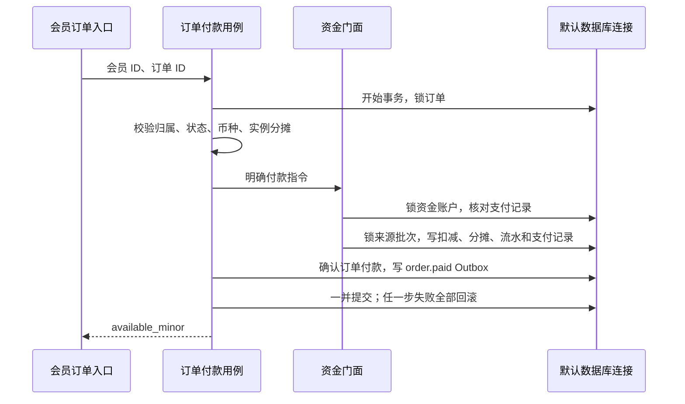

# 现有系统与 ORM 重构实施说明

更新日期：2026-10-01。

## 1. 范围与实施状态

本轮保持 Webman 模块化单体、现有前端技术栈、HTTP 路径、认证 Cookie、权限码与分页契约，整改现有持久化、余额付款编排及服务来源关联。未修改已执行的历史迁移，也未重建安装数据库。

| 状态 | 内容 |
|---|---|
| 当前实现 | 现有业务表的 37 个 Eloquent 模型、仓储输出白名单、模块内关联预加载 |
| 当前实现 | 订单余额付款用例、共享事务契约、资金来源扣减、显式 Outbox 写入 |
| 当前实现 | 服务首次订单单位关联、续费与升级单位到同一服务的多次关联 |
| 确定设计 | 插件使用受信预构建扩展、公开 SDK 与受控页面及 Slot 扩展点 |
| 后续建设 | 云产品配置、报价、真实支付渠道、可靠履约、Outbox 投递与消费、插件运行时、上下游交易 |

已有财务表和余额付款入口不代表购买、支付及资源交付已经形成可售闭环。本轮没有增加新的业务办理入口。

## 2. 模型、领域与仓储职责

业务模型位于 `backend/app/modules/<module>/infrastructure/model/`，类名使用 `Model` 后缀并继承 `support\Model`。

| 模块 | 已覆盖的表 |
|---|---|
| 系统访问管理 | 系统用户、部门、角色、用户角色、角色权限、角色部门 |
| 业务日志 | 管理员登录日志、管理员操作日志 |
| 会员 | 会员、分组、等级、实名认证 |
| 内容 | 分类、内容条目 |
| 工单 | 类型、快捷回复、工单、消息 |
| 设置 | 设置分类、设置项 |
| 订单 | 订单、订单项、订单单位 |
| 服务实例 | 服务实例 |
| 财务 | 充值、支付交易、支付通知、资金账户、来源批次、消费分摊、流水、退款申请、退款尝试、发票、开票分摊、提现、Outbox |

安装状态、迁移版本及升级运行记录继续由独立 PDO 工具访问。安装前的数据库探测不能依赖尚未配置的 ORM。

| 层与对象 | 职责 |
|---|---|
| Controller | 验证和转换 HTTP 输入，调用 Application，生成统一响应 |
| Application | 编排业务用例、控制事务、调用公开门面及 Contract |
| Domain 对象 | 表达业务身份、金额、状态及业务规则，不依赖 ORM |
| Repository Contract | 定义受控持久化输入和返回值 |
| Eloquent 模型 | 逻辑表名、字段转换、可写字段、隐藏字段、时间戳和模块内关联 |
| 只读查询实现 | 复杂后台联表、聚合与展示映射，不修改其他模块数据 |

### 2.1 数据库访问规则

- 普通单表查询和写入通过模型；新增使用 `create()`，普通编辑使用白名单 `fill()`/`save()`，状态变更使用带前置条件的模型更新。
- 批量处理、原子更新和复杂联表可以使用查询构建器。实名后台展示和工单展示分别收拢到 `RealNameAuthenticationReadQuery`、`TicketReadQuery`；服务实例仓储本身只承担只读展示查询。
- Controller、Application、Domain 不引用模型。会员仓储使用 `MemberProfile` DTO；登录查询返回原有账户领域对象，其他稳定简单结果保留受控数组。
- 模型声明不带连接前缀的逻辑表名，前缀由连接配置处理。金额和标识显式转为整数，业务时间保持 `Y-m-d H:i:s`，空值保持 `null`。
- API 使用明确查询列和输出白名单。模型 `hidden` 仅为额外保护，不能替代接口白名单。密码哈希、实名密文、凭证及私有配置快照不能自动进入响应。
- 实名指纹可由内部 Contract 提供给个人升级企业的匹配规则，但不进入公开资料。订单详情继续隐藏内部配置快照。
- 会员分页显式加载分组及等级；角色和系统用户显式加载模块内关联。查询次数不随每页条数增长。
- 跨模块写入通过公开 Application 门面或 Contract。会员的订单引用检查通过 `OrderMemberReferenceInterface`；复杂只读联表是限定的展示查询例外。
- 支付、扣款、外部任务不使用模型 Observer 隐式触发。

## 3. 余额付款编排

入口保持 `POST /api/console/v1/orders/{id}/pay-wallet`，控制器归属订单模块。成功响应仍返回 `available_minor`。

`PayOrderByWalletService` 负责订单所属会员、金额、币种、付款状态和实例分摊校验。`WalletLedgerService` 接收 `WalletOrderPayment` 指令，只核对资金支付记录、资金账户与来源批次，不查询或修改订单表。



### 3.1 事务与幂等

`TransactionManagerInterface` 的数据库实现在每次调用时取得当前默认连接。参与的模型与仓储使用相同连接；资金门面的嵌套事务仍处于订单用例的外层事务中。锁顺序固定为订单、资金账户、来源批次。

完整分摊要求每个订单项数量与单位数量一致、单位序号完整、金额非负且合计恰好等于订单应付金额。余额不足、分摊不完整或归属错误时没有资金变动。

已付款订单重试核对原钱包支付记录的会员、币种、金额和状态，返回当前余额，不再次扣款。并发请求由订单和账户行锁及数据库唯一约束控制。

充值匹配规则放在资金应用层，核对成功支付记录的会员、金额、币种、渠道及唯一性。仓储只负责锁定、读取和持久化。已入账充值重试不重复生成来源批次或流水。

`OutboxWriterInterface` 要求调用时存在事务。本轮保留 `finance_outbox` 表，只显式写入 `order.paid`，没有启动投递或履约消费者。外部支付验签、资源生产和消息恢复仍需后续建设。

## 4. 服务首次来源与多次交易

新增前向迁移 `20261001000200_link_service_origin_order_unit.php`：

1. 检查历史订单单位、订单项、订单和服务是否存在，所属会员是否一致；无效关联明确报错。
2. 增加 `service_instances.origin_order_unit_id`，可空且唯一，MySQL 添加指向订单单位的外键。
3. 从旧的唯一 `order_item_units.service_id` 关联回填首次来源。没有来源的历史服务保持 `null`。
4. 先增加 `idx_order_unit_service` 普通索引，再移除 `uk_order_unit_service`，保留原 MySQL 外键的索引依赖。
5. 服务列表通过首次订单单位查询来源订单；后续续费、升级单位可以关联同一服务，来源订单不改变，也不会使分页重复。

退款和发票继续关联各次交易自己的订单单位，不合并为一个服务级金额。`status=active` 前端显示“已开通”；资源开关机状态未来由生产能力单独提供。

迁移支持 MySQL DDL 部分完成、或 DDL 已完成但版本记录未提交后的重试。若已有多笔交易却没有明确首次来源，迁移报错，不选择最小 ID 猜测。迁移失败时运行器回滚仍活动的 PDO 事务，避免重试被残留锁阻塞。

此迁移不能自动回退为旧的唯一关联限制。上线前备份；异常使用明确的数据核查和前向修复，不能删除业务记录来强行通过升级。

## 5. 插件前端方向

前后端规范已取消复杂插件页面必须使用 iframe 的要求。确定方向为受信预构建扩展、公开 SDK 与受控页面及 Slot 扩展点，声明路由、权限、版本、动作和主题接口。

同域 JavaScript 是受信代码，不能当作安全隔离。运行时注册、加载、安装校验及升级兼容机制单列后续建设；本轮未实现或开放动态插件加载。

复杂产品继续由独立类型模型和专属组件处理配置联动、校验及计价。Schema UI 优先用于普通配置、附加字段及适合的插件界面。

## 6. 本轮验证证据

| 检查 | 实际结果与边界 |
|---|---|
| 重构前 PHPUnit 基线 | 143 个测试、623 个断言；已有 1 个弃用提示与 1 个 notice |
| 重构后默认 PHPUnit | 162 个测试、768 个断言；无失败；4 个 MySQL 专项按默认配置跳过；基线提示仍存在 |
| 独立 MySQL 集成测试 | 19 个测试、193 个断言通过；每个测试新建随机独立数据库并清理，不对安装库运行测试 |
| 模型兼容 | 整数、时间字符串、null、输出白名单、模块内预加载、个人升级企业、日志及工单内容读写通过 |
| 付款与事务 | 重复入账、重复支付、余额不足、错误归属、分摊缺失、支付记录冲突以及最后一步 Outbox 后异常全部回滚通过 |
| 真实行锁 | 两个独立 PHP 进程竞争同一订单只扣一次；两笔订单竞争余额不会透支 |
| 迁移 | 全新安装、自定义前缀、SQLite 与 MySQL 历史升级、无效历史拒绝、修复后重试、MySQL 部分 DDL 重试及外键保留通过 |
| 本地安装库 | 已备份后执行新增迁移；业务记录数与整数金额汇总核对一致；Webman 已重启 |
| 后台浏览器 | 已登录环境核对会员、系统用户、根部门编辑、角色权限、分页切换和操作日志详情；390px 下检查列表和详情 |
| 前端与静态检查 | 后台 lint/build、Composer 校验、PHP 语法和最终差异检查；构建仍有既有大 chunk 提示 |

权限表同时修正了三级菜单遗漏与共享权限码导致的重复行标识：表格行使用路由 key，授权仍使用原权限码。

本地会员、订单及服务实例数据较少或为空。浏览器空列表验证不能替代含数据的业务流程；含数据的仓储、资金和服务关联由独立测试库覆盖。财务开发预览仍显示明确标记的模拟数据，不能据此认定真实资金接口完成。真实支付商户、生产资源、对外插件及生产环境尚未验收。

### 6.1 重复执行的验证命令

```sh
cd backend
vendor/bin/phpunit
HOWSTACK_MYSQL_TEST=1 vendor/bin/phpunit tests/integration
composer validate --no-check-publish
```

MySQL 专项读取本地连接配置，只创建名称为 `howstack_orm_test_<随机值>` 的测试库；数据库账户须具有创建及删除这些测试库的权限。

```sh
cd frontend/admin
pnpm lint
pnpm build
```

## 7. 部署与升级

1. 备份数据库与现有发布文件，记录业务表数量及关键金额汇总。
2. 部署源码和构建产物，通过现有受控命令检查并执行新增迁移。
3. 重启 Webman，使依赖绑定及 Attribute 路由重新加载。
4. 核对认证、权限、查询、资金接口及迁移前后的业务数量和金额。

```sh
cd backend
php webman system:migration-status
php webman system:migrate --force --no-interaction
php start.php restart -d
```

运行参数沿用目标环境已有配置。本轮本地启动保持 `WEBMAN_COUNT=2 WEBMAN_DISABLE_REDIS_QUEUE=1` 的开发模式，不能将本地禁用队列配置当作生产任务可靠性的证明。

若发现资金或迁移异常，停止相关业务写入，保留错误与执行记录，按备份核对和前向修复处理。详细产品建设边界见 [云产品平台架构与开发方案](cloud-product-platform.md)；接口兼容说明见 [订单管理](../development/admin-orders.md) 与 [财务基础](../development/finance-foundation.md)。
