# 皓量云擎云业务运营系统架构

基准日期：2026-10-10。范围：当前 `howstack-bos` 工作区，包括未提交实现；不只对应 Git 已提交版本。读者：产品负责人、后端开发者、前端接入者和部署维护人员。

系统采用 **PHP Webman 模块化单体、独立前端应用、公共契约和受控业务插件**。订单、账务、产品规则保留在核心模块；外部服务由插件适配。现阶段应优先打通交易与交付闭环，继续使用这一结构。

本图册以控制器、应用服务、模型、迁移和进程配置为依据。蓝色表示存在实现，黄色表示能力部分落地或仍需外部联调，灰色虚线表示待建设。存在实现不等于生产验收通过。下文涉及部署拓扑的图是建议目标，数据库关系图是核心业务关系摘要。

配套文档：[系统缺陷与优化建议](system-improvement-review.md)。本次仅生成架构和建议文档，不修改业务代码、前端、依赖配置或数据库。

## 1. 系统总览

[可编辑 Mermaid 图源](diagrams/system-overview.mmd) · [PNG 图片](diagrams/system-overview.png)

### 访问端

| 入口 | 技术与目录 | 当前边界 |
| --- | --- | --- |
| 运营后台 | React 18、TypeScript、Vite、Arco；`frontend/admin/` | 系统配置、产品配置、后台代下单、财务办理、消息与审计等 |
| 会员控制台 | React 19、TypeScript、Vite、Arco、React Query；`frontend/console/` | 账号密码登录、手机号/邮箱注册、余额与站内消息；部分新登录入口只有前端接入约定 |
| 在线安装器 | React 19、Vite、Arco；`frontend/install/` | 环境检测、连接检测、安装和首次管理员初始化 |
| 官网 | Webman HTTP 首页；`backend/app/controller/IndexController.php` | 当前返回占位 HTML；`backend/themes/` 尚无完整主题实现 |
| API 文档 | OpenAPI、Scalar；`tools/api-docs/` | `/api-docs` 和契约读取要求管理员身份及文档权限，本地资源交付 |

开发时三个 Vite 应用独立运行。生产构建写入 `backend/public/`，由同域静态入口与 Webman 提供；客户服务器不需要运行 Node.js。`frontend/packages/` 是共享包预留目录，当前未形成可概括为成熟共享组件平台的内容。

### 接口入口

- 后台：`/api/admin/v1/`；会员：`/api/console/v1/`；公开能力：`/api/public/v1/`；安装：`/api/install/`。
- 全局显式路由在 `backend/config/route.php`，业务控制器使用路由 Attribute；默认控制器路由关闭。
- `ApiResponse` 和全局异常处理器提供 `code/message/data/request_id`；附件下载是明确的二进制响应例外。
- 安装、维护状态由全局中间件拦截；后台与会员各自鉴权，写操作按入口执行同源与业务授权检查。
- 后台菜单和按钮可见性只负责交互；最终权限由后端用例校验。会员数据归属以已认证的内部会员标识核对。

## 2. 后端分层与模块边界

[图源](diagrams/backend-boundaries.mmd)

图中箭头表示代码依赖或调用方向；“实现接口”是接口实现关系，不是网络请求。图中多个模块共享一个代码库与业务数据库，不代表独立部署的微服务。

| 层 | 职责 | 约束 |
| --- | --- | --- |
| Controller / Middleware | 请求、验证、身份、响应转换 | 不直接处理 ORM 或外部平台业务 |
| Application | 用例、权限、事务和跨模块编排 | 通过公开门面或 Contract 协作 |
| Domain | 金额、计价、组合限制、状态不变量 | 不依赖数据库、HTTP、Redis 和供应商 SDK |
| Contract | 仓储、网关、稳定公共能力 | 明确输入输出和失败语义 |
| Infrastructure | Eloquent、Redis、HTTP、队列、文件 | 实现接口，通过 `config/dependence.php` 绑定 |
| Shared | 公共响应、事务、加密、IP、插件 SDK | 不成为收容所有业务规则的公共层 |

简单 CRUD 可使用精简层次；计价、资金、订单、履约使用更完整领域规则。只读跨模块聚合允许集中在 Infrastructure 查询实现，写入仍由所属模块负责。

### 当前全部业务模块

下表覆盖 `backend/app/modules/` 的 23 个一级目录；`admin` 内进一步区分认证、组织权限、操作日志等子模块。

| 模块 | 负责的业务 | 当前状态与边界 |
| --- | --- | --- |
| `admin` | 管理员认证、用户、部门、角色权限、审计 | 已有实现；每次请求核对身份及适用权限 |
| `member` | 会员、分组、等级、注册、认证记录 | 密码登录、注册验证码、人工实名审核已实现；新登录和找回流程待接入 |
| `system_settings` | 基础、安全、注册登录、机器人设置 | 已有实现；机器人连接集中维护 |
| `compute` | 云资源、线路网络、计价、购买限制、库存 | 云服务器规则已实现；按量和密钥登录当前拒绝 |
| `product` | 产品身份、销售配置、发布快照、购买与库存契约 | 类型注册目前只提供云服务器处理器 |
| `provider` | 供应连接、目录、资源映射、参数映射 | 魔方云认证和只读目录；交付参数预览不执行开通 |
| `order` | 订单、订单项、实例金额单元、后台购买、余额付款 | 后台正价云订单和余额支付已实现；会员自助创建、续费升级待接入 |
| `finance` | 钱包、来源批次、流水、充值、退款、开票、提现 | 社区版办理已实现；线上支付、原渠道退款、税务签发与自动打款未形成闭环 |
| `service_instance` | 已存在服务实例查询和来源关联 | 有查询与关联结构；没有自动资源生产能力 |
| `support` | 工单类型、部门关联、工单回复、快捷回复 | 有后台办理及回复通知接入 |
| `content` | 帮助、新闻、分类、正文与图片 | 后台内容管理已实现；不代表官网公开内容展示完成 |
| `business_analysis` | 日期聚合、实付、退款、订单、会员统计 | 后端实现及索引存在；净实付不等于利润或现金流 |
| `message_configuration` | 业务场景、渠道模板、接收策略 | 社区版简化入口，底层仍保留接收组扩展 |
| `message` | 发布、任务、队列、尝试、收件箱与消息日志 | 已有发送运行时；公众号发送未接入，预置场景不等于全部业务触发 |
| `channel` | 各类通道配置、宿主执行门面、私有存储下载 | 已有实现；适配器返回结果不自动完成对应业务 |
| `plugin` | 包注册、摘要审核、启停、引用保护、依赖加载 | 同进程受信代码；不是代码执行沙箱 |
| `official_platform` | 官方账号连接、安装身份、签名客户端 | 有本地实现；外部官方平台属于另一套部署 |
| `licensing` | 证书校验、期限、商业功能门禁 | 无证书默认社区版；不是仅靠菜单隐藏分版本 |
| `application_center` | 已获取应用安装更新入口 | 调用软件维护流程；真实包交付仍需官网联调 |
| `software_maintenance` | 包验签、备份、安装、维护锁、恢复状态 | 本机维护流程；多节点一致升级尚未设计完成 |
| `system_update` | 系统版本、迁移、更新检查 | 与软件维护协作；前向迁移不能假定自动回滚 |
| `install` | 环境检测、初始化、安装保护 | 有实现；未安装时限制业务入口 |
| `api_documentation` | 受保护文档与契约服务 | 有实现；仍存在成功响应 Schema 缺口 |

报价规则目前包含在产品类型处理器中，支付门面在 `channel` 和财务用例中；尚无完整的独立 `fulfillment`、`marketing` 或 CRM 模块。物理服务器、托管的服务记录查询也不等于这些产品的购买处理器已实现。

## 3. 订单与财务数据架构

[图源](diagrams/commerce-data.mmd)

该图仅列关键字段，关系表示业务关联，不能直接当成全部数据库外键 DDL。`refund_requests.source_type/source_id` 是多态业务来源，图中限定为 `order_unit`。可空服务关联允许同一服务被后续多次交易引用；`service_instances.origin_order_unit_id` 另外记录唯一首次交付来源。

### 交易与资源分开

- **订单**：一次交易的会员、币种、应付、实付和付款状态。
- **订单项**：某产品类型、版本和配置，包含数量以及不可变配置/费用快照。
- **实例金额单元**：每台独立金额归属、退款预留、已退与服务关联。
- **服务实例**：长期资源身份、有效期和业务状态；当前付款不会自动创建服务。

一次购买三台相同配置：一个订单、一个数量为 3 的订单项、三个实例单元。优惠后实付 270 元时可各归属 90 元；金额按整数分稳定分摊并处理尾差。某一台全额退款不改变另外两台的金额归属。

续费和升级应形成新交易并引用已有服务，不能改写最初的购买金额。当前数据关系可承载这种关联，业务办理尚未完成。

### 账务与额度

- `wallet_accounts` 维护当前余额；`wallet_entries` 保留不可变资金流水。
- `wallet_funding_lots` 保留充值来源；`wallet_consumptions` 追踪订单消费及退款恢复，退款不伪造新的充值收入。
- 退款、开票和提现各有状态及额度约束；发票分配和退款共同约束实例实付，不能重复占用。
- 社区版退款当前办理已核实余额付款，退回原资金批次。提现当前是指定充值来源的未消费现金退还，使用冻结流程，不是任意余额出金。
- 发票登记与红冲登记保留额度归属；不代表已经对接税务平台完成真实签发。
- 经营分析直接聚合当前交易事实，不展开多实例导致销售额重复，也不凭当前价格重算历史收入。

## 4. 订单付款与履约边界

[图源](diagrams/order-payment.mmd)

**已经实现的链路**：服务端重新校验已发布版本 → 创建订单/单元/快照 → 余额付款 → 同事务写入流水、库存、付款状态和事件。余额、库存或事件写入失败整笔回滚；幂等键阻止相同请求重复创建。

**尚未接通的链路**：消费付款事件 → 创建每实例履约任务 → 调用供应商生产接口 → 查询未知结果 → 成功绑定服务 → 聚合部分交付状态。`finance_outbox` 当前只写记录；消息运行时的数据库任务和消费者不能替代交易履约事件消费者。

供应配置映射是“标准产品配置到提供者参数”的翻译，不是生产任务。正式生产需要独立的幂等标识、租约、尝试记录、错误分类和恢复逻辑。付款状态、订单交易状态、单台履约状态、服务有效期和供应资源运行状态应分别管理。

推荐保留订单项与实例单元。只有独立交易主体、独立支付或独立结算等真实需求出现时，才进一步引入父子销售订单；多供应商交付可先使用履约任务或采购单。

## 5. 消息与验证码架构

[图源](diagrams/message-runtime.mmd)

### 普通业务消息

`messages` 表示逻辑消息；`message_recipients` 表示接收对象与已读；`message_deliveries` 表示渠道任务与加密快照；`message_delivery_attempts` 表示逐次尝试。

业务事务写入消息与任务，10 秒维护扫描向 Redis 发布 `delivery_id`，消费者从数据库原子领取并持有 120 秒租约。Redis 用作唤醒与传输，不是消息事实的唯一存储。补投和状态领取共同应对断线、重复入队和消费者故障。

- `accepted`：外部平台明确受理，不等于最终送达。
- `delivered`：当前主要表示站内消息可见，不等于已读。
- `failed`：明确失败，按分类有限重试。
- `unknown`：外部结果未知，不自动重发。

已接入付款、充值、工单管理员回复、实名审核等业务事件。公众号有模板配置，但发送未集成；其他预置场景需逐一接入真实业务用例。

### 注册验证码

注册验证码独立即时发送，使用账号、场景与浏览器绑定，保存挑战摘要，执行期限、次数、单次消费和 Redis 限流。它复用通道运输能力，但不进入普通通知队列、收件箱或正文日志。

验证码关闭时不把联系方式标为已验证。现有验证码消费和创建会员分别提交，创建失败后需重新获取。后续短信登录、找回密码应有各自场景和挑战，不直接复用注册挑战。

## 6. 插件与第三方集成

插件位于 `backend/plugins/<category>/<plugin_id>/`，清单声明配置、固定入口、能力与网络范围，宿主负责审核、安装状态、通道修订和执行门面。当前共有 23 个内置清单，分为 8 个已有类别：

| 类别 | 当前插件 |
| --- | --- |
| 资源供应 | 魔方云 |
| 支付 | 支付宝订单码、微信 Native |
| 实名 | 支付宝身份验证、腾讯云人脸核身 |
| 短信 | 阿里云、腾讯云、赛邮、短信宝 |
| 邮件 | SMTP、阿里云邮件推送、腾讯云邮件推送 |
| 存储 | 本地、阿里云 OSS、腾讯云 COS、七牛 REST |
| 第三方登录 | 微信、QQ |
| 人机验证 | 图像验证码、极验 4、网易云盾、腾讯云、阿里云验证码 |

产品扩展和专项功能类别为边界预留，不列为已交付插件。

插件适配器存在不代表支付、会员认证、文件上传等业务全部接通，也不代表已完成真实厂商验收。供应 SDK 当前只有认证、目录和绑定校验；支付有创建、查询、关闭、通知验签门面，尚缺交易回调与入账闭环；OAuth 有 state 与授权码门面，尚缺会员身份绑定和会话签发流程。

### 依赖与信任边界

- 允许插件本地 Composer，需锁文件和生产依赖；宿主拒绝越界声明、安装扩展及不一致依赖。
- SMTP 等依赖在对应插件；支付宝当前仍使用主 Composer 中的 Easy SDK。这是现状，不是所有新插件依赖必须进入核心的规范。
- 同一 PHP 进程共享类空间，独立 `vendor/` 不形成版本隔离。同名依赖不同版本当前明确拒绝，避免加载顺序决定行为。
- 公共 HTTP 提供 GET、POST、PUT、DELETE 等方法；供应专用客户端约束审核端点、TLS、跳转、超时与响应大小。
- 插件代码是受信 PHP，可以使用其 SDK；声明式边界不是强制执行沙箱。引入不受信代码应另建独立进程或远程边界。
- 通道配置、供应凭据和部分任务快照使用宿主加密能力；密钥必须跟数据库、私有身份文件一并制定备份恢复方案。

## 7. 安装、授权与软件维护

在线安装器调用后端完成配置和迁移。已安装状态限制安装入口。官方平台是外部系统，负责账号、授权证书、版本和包服务；当前仓库负责客户端与本机执行。

商业能力由已验签证书、安装身份、期限和本机功能目录共同决定，无有效商业证书默认社区版。当前功能目录只有粗粒度专业/企业标识，不等于 CRM、按量计费等商业业务已经实现。

软件维护流程使用包校验、下载限制、本机全局锁、备份、维护状态和固定 CLI 子进程。文件替换阶段可恢复；数据库迁移阶段失败进入 `recovery_required`，不能承诺自动回滚整个升级。

本机全局锁和私有目录适合现阶段单节点部署，不能直接宣称支持多节点滚动更新。官方平台联调、真实包安装和恢复演练另行验收。

## 8. 部署与运行目标

[图源](diagrams/deployment-target.mmd)

图中 Nginx/TLS 与发行流水线是建议配置，当前 `deploy/` 为空。Webman 进程、队列、MySQL/Redis 使用已有实现。它们可以在一台机器上部署，不要求上微服务或 Kubernetes。

| 运行组件 | 依据 | 维护注意事项 |
| --- | --- | --- |
| HTTP Workers | `backend/config/process.php` | 当前默认按 CPU 配置进程数；上线应结合内存和数据库连接预算调整 |
| 消息维护 Worker | `backend/app/process/MessageDeliveryWorker.php` | 每 10 秒扫描；数据库事实保留，Redis 故障后可补投 |
| Redis 消费者 | `backend/config/plugin/webman/redis-queue/process.php` | 默认 2 个，可配置；实例前缀隔离，不共用其他安装队列身份 |
| 软件维护 Worker | `backend/app/process/SoftwareMaintenanceWorker.php` | 每 15 秒发起固定 CLI；不在 HTTP Worker 内执行长时升级 |
| MySQL | 模型与 Phinx 迁移 | 资金、订单、库存事务；备份与恢复演练不可省略 |
| Redis | 队列、限流、OAuth state | 不是财务事实库；不可用时部分注册写入关闭 |
| 私有目录 | 存储与官方平台配置 | 不公开映射；保存身份、密文关联资料和更新备份 |

发行包需包括核心生产 `vendor/`、插件各自生产 `vendor/`、锁文件、迁移、三个前端构建与 API 文档本地资源。当前 Dockerfile 的 PHP 8.3 与项目 PHP 8.4 要求冲突，生产容器必须先修正并验收。

## 9. 契约与验证体系

`contracts/openapi/` 是接口文档唯一源；产品与插件 JSON Schema 位于 `contracts/`，工具从实际注册路由核对契约并构建受保护资源。

当前 `tools/api-docs/response-gaps.v1.json` 有 **39 项已有成功响应 Schema 缺口**。路由已覆盖不代表响应完整，新增接口不允许新增缺口豁免。后台创建、财务动态资源与产品配置等应逐步补齐 DTO。

现有测试包括 PHPUnit 单元、隔离 SQLite、按开关执行的 MySQL 集成、前端 Node 测试和浏览器脚本。存在测试文件不表示此次全部执行。唯一工作流当前主要检查 API 文档与少量相关测试，尚不是完整业务发布门禁。

### 本图册的证据范围

本次核对本地源代码、依赖声明、迁移、实际路由定义、文档构建工具与前端调用约定，并校验图源渲染和文档链接。不启动交易、不修改数据库、不发送验证码、不联系真实支付/供应商，也不把旧文档中的完成声明替代当前实现。

进一步建设顺序及逐项验收见 [优化建议与路线](system-improvement-review.md)。

## 10. 关键源码索引

| 内容 | 本地依据 |
| --- | --- |
| 路由与运行进程 | [route.php](../../backend/config/route.php)、[process.php](../../backend/config/process.php) |
| 容器与模块接口 | [dependence.php](../../backend/config/dependence.php)、[后端规范](../../backend/AGENTS.md) |
| 订单付款与分摊 | [付款用例](../../backend/app/modules/order/application/PayOrderByWalletService.php)、[金额分摊](../../backend/app/modules/order/domain/OrderUnitAllocator.php) |
| 财务用例与事实事件 | [财务办理](../../backend/app/modules/finance/application/ManageFinanceService.php)、[Outbox 写入](../../backend/app/modules/finance/infrastructure/DatabaseOutboxWriter.php) |
| 产品计价 | [类型注册器](../../backend/app/modules/product/infrastructure/ProductTypeRegistry.php)、[包年包月处理器](../../backend/app/modules/compute/domain/PrepaidComputeTypeHandler.php) |
| 供应商边界 | [固定供应 SDK](../../backend/app/shared/plugin/contract/ProviderAdapterInterface.php)、[供应开发说明](../development/provider-adapters.md) |
| 消息 | [发布与派发模块](../../backend/app/modules/message/)、[运行时说明](../development/message-runtime.md) |
| 注册 | [验证码发送](../../backend/app/modules/member/application/SendRegistrationCodeService.php)、[注册说明](../development/member-registration.md) |
| 插件 | [注册器](../../backend/app/modules/plugin/infrastructure/LocalPluginPackageRegistry.php)、[依赖加载](../../backend/app/modules/plugin/infrastructure/PluginDependencyLoader.php) |
| 软件更新 | [本机安装器](../../backend/app/modules/software_maintenance/infrastructure/LocalReleaseInstaller.php)、[运行维护任务](../../backend/app/modules/software_maintenance/application/RunInstallationJobService.php) |
| 经营统计 | [查询实现](../../backend/app/modules/business_analysis/infrastructure/DatabaseBusinessAnalysisRepository.php)、[统计口径](../development/business-analysis.md) |
| 前后端能力边界 | [控制台登录约定](../../frontend/console/login-integration.md)、[会员后端入口](../../backend/app/modules/member/controller/MemberAuthController.php) |
| 发布缺口 | [Dockerfile](../../backend/Dockerfile)、[CI](../../.github/workflows/api-documentation.yml)、[响应缺口](../../tools/api-docs/response-gaps.v1.json) |
