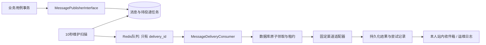

# 消息运行时 v1

## 范围与入口

消息配置决定事件、接收对象、渠道及模板，`backend/app/modules/message/` 负责生成任务、可靠入队、发送、站内收件箱和运维日志。复用已经安装的邮件与短信插件，不再建立第二套厂商 SDK 接口。

当前已接入：

| 业务用例 | 事件 | 接收对象 |
| --- | --- | --- |
| 订单余额付款提交 | `order_paid` | 关联客户、配置选定的管理员、机器人群 |
| 已确认充值入账 | `recharge_received` | 关联客户 |
| 管理员回复工单 | `ticket_replied` | 关联客户，不通知“客户回复工单”管理员场景 |
| 实名认证审核 | `real_name_approved` / `real_name_rejected` | 关联客户 |

发送适配器覆盖站内消息、邮件、短信、钉钉、企业微信、飞书。公众号保留模板配置，尚无发送实现；其任务明确失败为 `channel_not_integrated`，不能将配置启用当作已支持发送。其余预置场景还需由真实业务用例调用公共发布契约，不因为配置页面有一行就自动触发。验证码被普通发布入口明确拒绝，后续需独立实现有效期、单次消费、频率限制与验证流程，不能混进普通收件箱或消息日志。

所有渠道初始仍为禁用。本次迁移不会替客户开启通知、切换原通道或触发历史事件补发。

后台：

- 系统管理 → 消息配置：选择模板与接收对象。
- 日志审计 → 消息日志：查看逻辑消息、渠道任务、尝试状态；明确失败可按权限人工重试。
- 顶栏消息中心：读取当前管理员真实站内消息，展开后持久化已读，未打开也显示未读徽标。
- 会员中心顶栏：仅当前会员的真实站内消息与已读状态。

## 架构与持久化



| 表 | 职责 |
| --- | --- |
| `messages` | 场景、用途、业务引用、唯一事件摘要 |
| `message_recipients` | 客户、管理员或群的接收记录；站内独立已读时间 |
| `message_deliveries` | 每个接收对象每个渠道的任务、加密快照、固定请求标识、状态及租约；同时是事务 Outbox |
| `message_delivery_attempts` | 每次领取结果、安全错误编码、耗时 |

逻辑消息不因渠道数量增加多行，接收记录不因一个人选了两条渠道重复，任务唯一键为接收记录与渠道。重试是同一任务的新尝试，保持相同请求标识。记录逻辑事件与记录任务在业务默认数据库事务内完成，不在事务中发送网络请求。已提交事件重复发布不改原快照，也不因后来修改模板补发。

## Redis 队列与恢复

使用 [Webman Redis 队列](https://www.workerman.net/doc/webman/queue/redis.html)，依赖 `webman/redis-queue`，复用系统 Redis 连接环境变量。

- 固定队列名称：`howstack.message.delivery`。
- 消息只有 `{ "delivery_id": 123 }`。不包含邮箱、手机号、正文、验证码或 Webhook。
- `RedisMessageQueue` 使用同步 `Webman\RedisQueue\Redis::connection(...)->send(...)`；收到 Redis 的确定成功后才更新数据库补投时间。
- `MessageDeliveryWorker` 每 10 秒扫描最多 100 条到期任务。Redis 断开时任务留在数据库，下轮继续尝试。
- 成功入队后 60 秒补投租约。如果队列任务丢失、服务重启或消费滞后，重新发布同一个 ID。消费端以数据库状态原子领取，不会因为重复队列消息重复发送。
- 领取使用数据库事务、行锁、随机令牌和 120 秒租约。完成时核对令牌，过期进程不能覆盖新状态。
- 外部发送进程中断不能证明没有发送，租约过期记 `unknown`；站内入箱无外部副作用，可恢复为待处理。
- 多个安装实例共享 Redis 时默认按 `APP_KEY` 与数据库身份派生前缀；也可显式设置 `REDIS_QUEUE_PREFIX`。同一安装所有进程保持一致，不能复用其他安装的前缀。

Redis 的自动重投仅用于消费者异常；业务的失败退避由数据库任务管理。队列 ACK、厂商受理、最终送达和用户阅读分别处理。

## 结果状态

| 状态 | 含义 | 自动处理 |
| --- | --- | --- |
| `pending` | 等待或退避中 | 到期补投 |
| `processing` | 已领取，租约内 | 等待本次结果 |
| `accepted` | 厂商明确受理 | 停止发送；不等于最终送达 |
| `delivered` | 当前实现只用于站内消息已经可见 | 停止发送；不等于用户已读 |
| `failed` | 明确失败 | 可重试失败最多自动尝试 3 次；配置、接收人无效及机器人拒绝不自动重试 |
| `unknown` | 超时、响应不可信、外部进程中断 | 不自动重试，不允许直接点击重试 |

人工重试要求 `admin.message-logs.view` 和 `admin.message-logs.retry`，仅 `failed` 且累计少于 10 次。原模板、通道引用和请求标识保持不变。通道或机器人配置修订变化时停止发送；不能把旧任务静默切到新通道。此版本未提供未知结果自动查询或强制补发，需先核对厂商流水。

## 接收对象、模板与隐私

客户从业务关联的会员 ID 解析，不接受浏览器任意指定手机号或邮箱。管理员默认创始管理员，也可按启用部门、角色或指定管理员选择，实际发送只匹配当前启用账户。部门、角色投影去重；机器人各渠道每事件只发一次，群 Webhook 仍统一来自系统设置。

发布时封存模板渲染结果、地址、消息修订、通道 ID/修订；机器人封存加密凭据快照和全局修订。模板仅支持目录中声明的 `{{变量名}}`，不执行表达式、PHP、Twig 或远程 URL。邮件/短信发送前重新验证通道，停用接收人不再投递。

投递快照加密持久化，日志页面不返回正文、邮箱、手机号、证件数据、Webhooks、厂商原始响应或异常信息。收件箱解密后仅向认证的接收人返回其正文；账户 ID 由服务端认证上下文确定，其他人标记已读返回 404。每个接收人的已读时间独立，邮件受理和群机器人受理不会将站内消息标记已读。

## 业务开发接入

在 Application 用例注入 `MessagePublisherInterface`，在业务事务内发布确定已发生的事件。使用稳定业务事件键；多次回复等事件用回复记录 ID，不能仅用工单 ID。明确受众，避免客户回复与管理员回复通知方向混淆。

```php
$this->transactions->run(function () use ($order): void {
    // 完成当前模块的持久化操作，再生成同事务通知。
    $this->messages->publish(
        'order.paid.' . $order->id,
        'order_paid',
        'order',
        $order->id,
        $order->memberId,
        ['site_name' => '站点名称', 'order_no' => $order->number, 'amount' => '12.00'],
        ['customer', 'admin'],
    );
});
```

不使用模型 Observer 隐式发送，不调用插件直接绕过任务仓储，不在消费者中把未知资金或履约结果通知为成功。新增场景同步目录、分类、变量和实际业务接入测试。

## API 与权限

接口契约见 `contracts/openapi/messages.v1.yaml`，消息配置契约另见 `admin-message-configurations.v1.yaml`。

| 方法 | 接口 | 授权 |
| --- | --- | --- |
| GET | `/api/admin/v1/messages`、`/summary` | 当前管理员会话 |
| POST | `/api/admin/v1/messages/{id}/read`、`/read-all` | 当前管理员 + 同源 |
| GET / POST | `/api/console/v1/messages` 的相同接口 | 当前会员 + 写入同源 |
| GET | `/api/admin/v1/message-logs`、`/{id}` | `admin.message-logs.view` |
| POST | `/api/admin/v1/message-logs/deliveries/{id}/retry` | view + retry + 同源 |

收件箱按分类、子分类和服务端分页读取。日志独立按场景与业务类型 AND 过滤，支持时间排序，查询后回到第一页；条件和分页写入 URL。后台消息日志只显示统计、渠道结果和尝试记录。

管理员消息中心保留旧更新摘要的只读提示作为兼容；它尚未转成后端 `system_update` 事件，其本页已读状态与数据库消息区分。演示消息只有开发环境显式 `notificationMock=1` 时才加载，默认不伪造消息。

## 安装与运行

1. 备份数据库，并确认备份成功。
2. `php webman system:migration-status` 检查；`php webman system:migrate --force` 执行前向迁移。
3. 完整执行 `php start.php restart -d`，DI、路由和进程变更不能只 reload。
4. 检查 Redis 配置，队列消费者默认为 2，可设 `MESSAGE_QUEUE_WORKERS`。本地调试不要设置 `WEBMAN_DISABLE_REDIS_QUEUE=1`，该变量会禁用消费者。
5. 在消息配置启用所需场景和渠道；邮件/短信选已启用通道，管理员选择接收对象，机器人先维护全局设置。
6. 用授权测试账户产生真实业务事件，通过消息日志核对任务及结果，再做厂商实际发送验收。

迁移 `20261007000500_create_message_runtime.php` 新增四表；`20261007000600_complete_message_runtime_comments.php` 前向补齐状态字段中文说明，不删除已有业务数据。

## 验证与边界

```sh
vendor/bin/phpunit tests/integration/MessageRuntimeTest.php tests/integration/MessageRuntimeMigrationTest.php
vendor/bin/phpunit tests/unit/modules/message/InstalledMessageTransportTest.php
HOWSTACK_MYSQL_TEST=1 vendor/bin/phpunit tests/integration/MessageRuntimeTest.php tests/integration/MessageRuntimeMigrationTest.php
HOWSTACK_REDIS_TEST=1 vendor/bin/phpunit tests/integration/MessageRedisQueueTest.php
```

MySQL 验证使用独立测试数据库，Redis 验证使用随机隔离队列前缀与独立消费者，站内消息真实落库；厂商发送使用替身，不联系现有客户。浏览器验证涵盖桌面/390px、徽标初始显示、展开已读及刷新保持；模拟接口验证不替代正式账户与厂商送达验收。


## 接收组策略与聚合日志

消息场景从 `MessageTypeCatalog` 声明读取客户/内部/机器人组。每个组封存自己的接收范围和模板；发送资格仍由业务事件声明的受众决定。配置中加入管理员组不意味着客户专用事件自动发给管理员。相同事件、同账号、同渠道去重，以靠前组模板为准；群机器人按平台去重。

`message_recipients.group_key/group_name` 保存事件发生时的组快照，历史记录默认为 `legacy`/空名称，展示为历史接收组。配置改变不会改已排队的任务。配置读取按需转换旧受众结构，不写空记录；新版保存后 `_groups` 优先。

日志一行一条逻辑消息，新增 `status` 和脱敏接收组/渠道摘要。状态按实际投递聚合：无任务 inactive；存在未知 unknown；有处理 processing；有待发 pending；全部送达 delivered；全部受理或送达 accepted；有成功受理但部分失败 partial；其余 failed。未知/待发优先显示，不能将部分已受理冒充全部完成。`accepted` 严格表示厂商受理，并非最终送达。聚合由查询实时计算，无缓存状态漂移。

日志查询按场景、用途、渠道、投递结果独立 AND 过滤；渠道及投递结果条件约束同一投递任务，避免“邮件失败、站内成功”被误匹配成“站内失败”。详情展示组名、接收账号、各渠道结果、已读及发送尝试；不输出正文、联系方式、验证码或凭据。场景选项由日志查看权限接口提供，不要求额外消息配置权限。

## 社区版消息日志

- 列表展示消息场景、类型、关联业务、接收对象（客户／管理员／机器人）、渠道、总体结果和记录时间。接收组名称与精细范围保留在详情，不暴露在普通列表。
- 社区版查询区只显示场景、渠道、发送结果、记录日期范围四项独立条件，按 AND 组合；消息类型通过表头筛选，不再重复放入查询表单。后端仍支持接收对象、投递结果、业务类型与业务 ID 等高级查询，供后续扩展。业务 ID 指关联业务主键，不作为订单号或工单号。
- 桌面四项 inline 展示，窄屏在筛选抽屉中填写。查询／重置归第一页，条件及排序同步 URL，关闭详情和刷新保留列表状态；历史链接中的已移除查询条件会清理，避免隐形筛选。
- 总体结果按整条消息的全部投递聚合，不受渠道筛选裁剪；接收对象、渠道与投递结果必须匹配同一条投递。全部筛选在数据库中分页前执行，日期按本机记录时间解释，结束日期包含整天。
- 详情先显示各渠道的发送通道、状态、失败原因与更新时间；尝试记录默认折叠，可按需查看。更新时间只表示任务最后更新，不当作发送或最终送达时间；已读仅适用于站内消息。
- `20261007000800_add_message_delivery_channel_name.php` 添加 `message_deliveries.channel_name` 公开名称快照。创建任务时通过通道公开投影读取绑定的平台名称，不解密通道凭据；日志查询不解密投递载荷。历史记录空值显示“未记录”，不能用当前配置或编辑后的名称冒充历史快照。升级前备份，执行系统迁移并完整重启。
- 本次保持受理、送达、未知等原有语义及服务端重试权限／次数约束；明确失败才允许重试，未知结果先核实。保存、查看和筛选不会触发发送。
